# Proof | Insurance Claims Management

Proof is a frontend-only workspace for reviewing auto insurance claims, tracking evidence, managing settlements, and monitoring claim operations. It is designed as a polished product interface with a realistic in-memory demo dataset.

## Live demo

[Open Proof](https://a2rp.github.io/insurance-claims-management/)

## Product views

- **Claims queue** at `/`: search, filter, sort, review claim summaries, and export a CSV.
- **New claim** at `/new-claim`: validate claimant and incident details, preview the reserve calculation, and create a demo claim.
- **Claim file** at `/claims/:claimId`: review the timeline and evidence checklist, add notes, edit the reserve, assign an adjuster, change claim stage, approve or decline a claim, and remove a claim with confirmation.
- **Payment desk** at `/payments`: review settlement records, filter by payment status, place or release a hold, issue a demo settlement, and export the ledger.
- **Claims report** at `/reports`: filter reporting data, select a stage from the chart, review adjuster workload, and export a CSV.
- **Not found**: branded recovery links for unknown routes.

## Behavior and scope

The interface is interactive and keeps demo changes in React memory only. Refreshing the page resets the sample data. It does not use browser storage or a backend. Evidence checklist and notes are illustrative; documents are not uploaded or stored. Payment actions update the demo ledger only and do not send money. CSV exports are generated in the browser.

## Run locally

```bash
npm ci
npm run dev
npm run lint
npm run build
npm run deploy
```

## Screenshots

### Pages

| View | Screenshot |
| --- | --- |
| Claims queue | 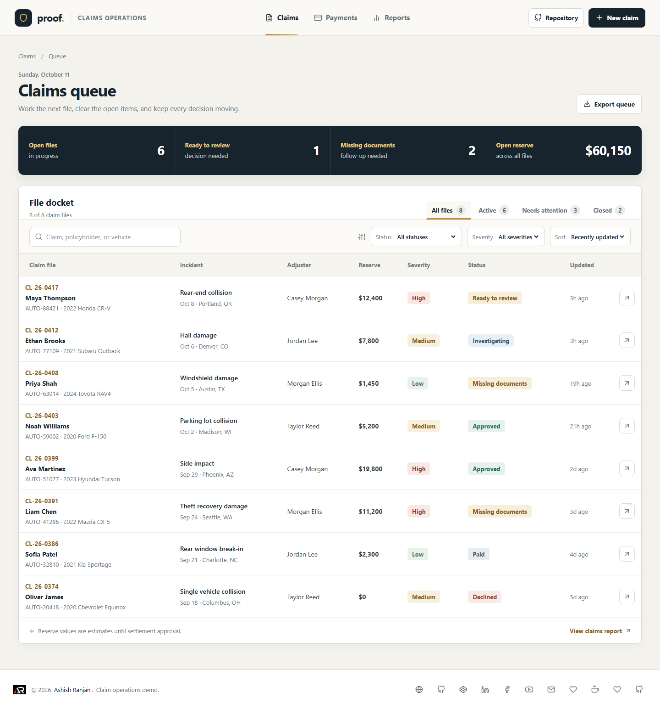 |
| Claims queue on mobile | 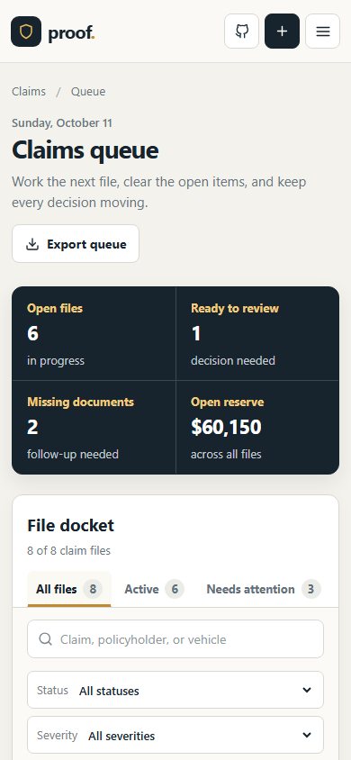 |
| New claim | 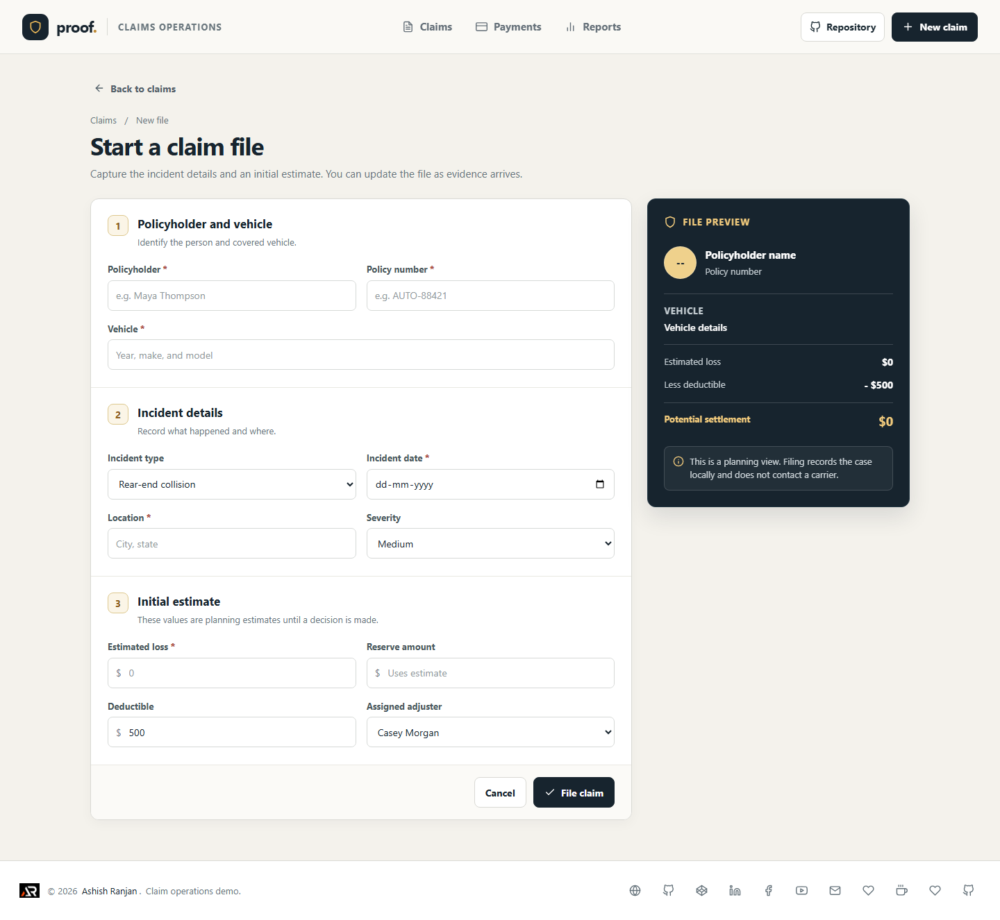 |
| New claim validation | 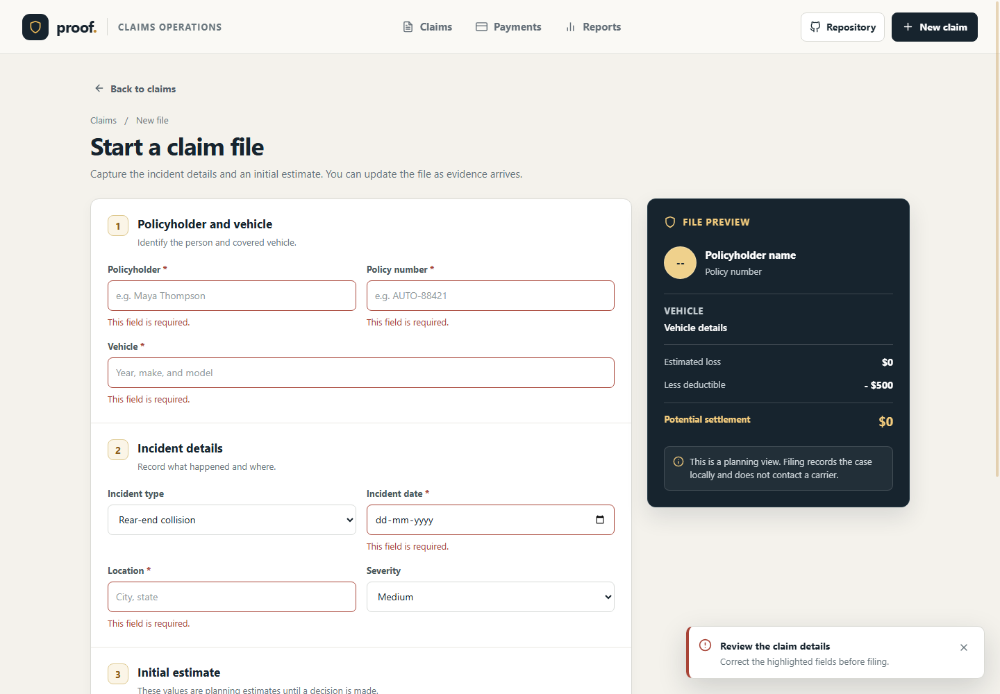 |
| Claim file | 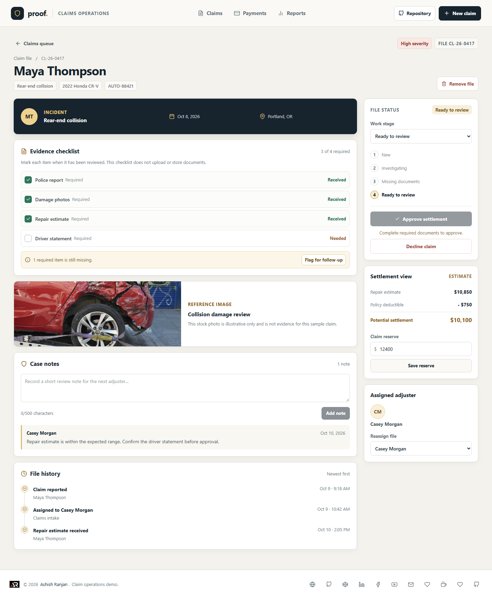 |
| Payment desk | 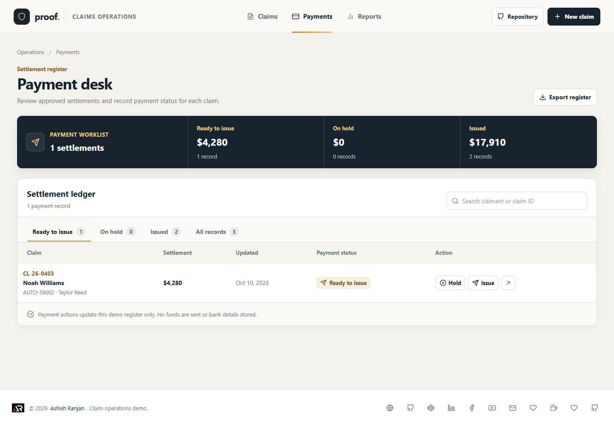 |
| Claims report | 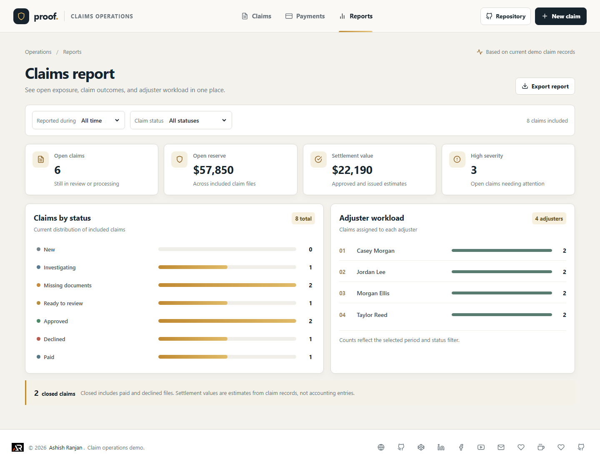 |
| Not found | 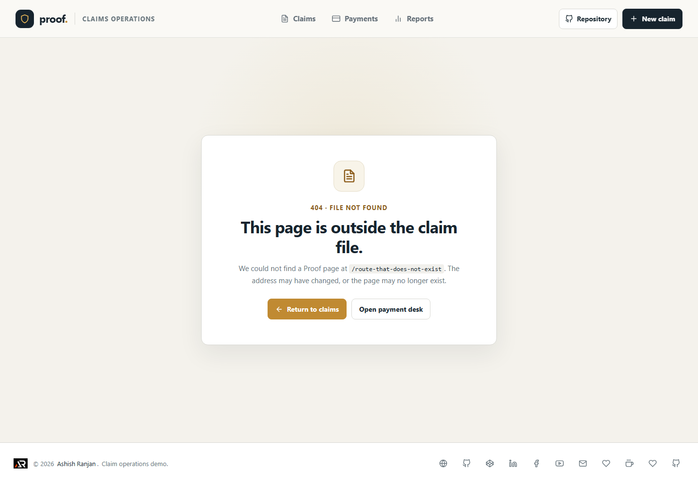 |

### Confirmation dialogs

| Action | Screenshot |
| --- | --- |
| Approve settlement | 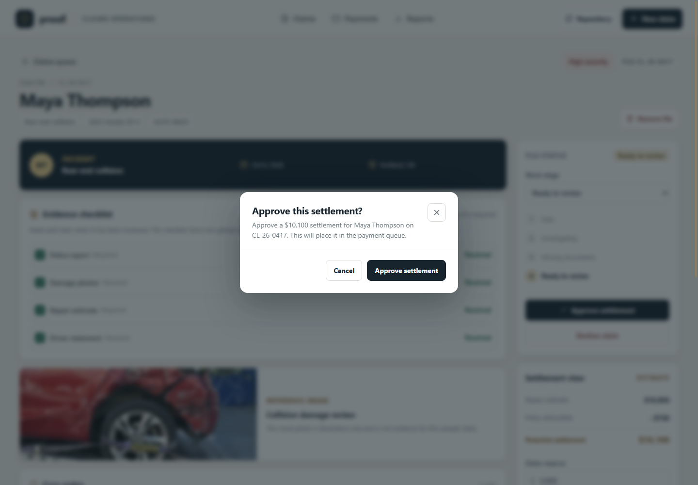 |
| Decline claim | 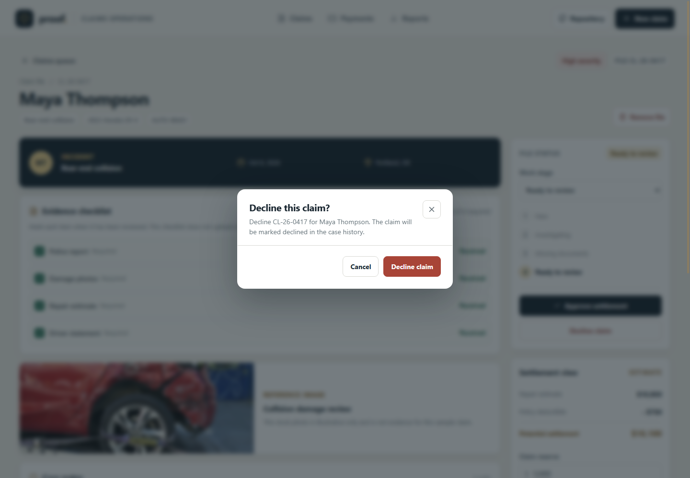 |
| Remove claim | 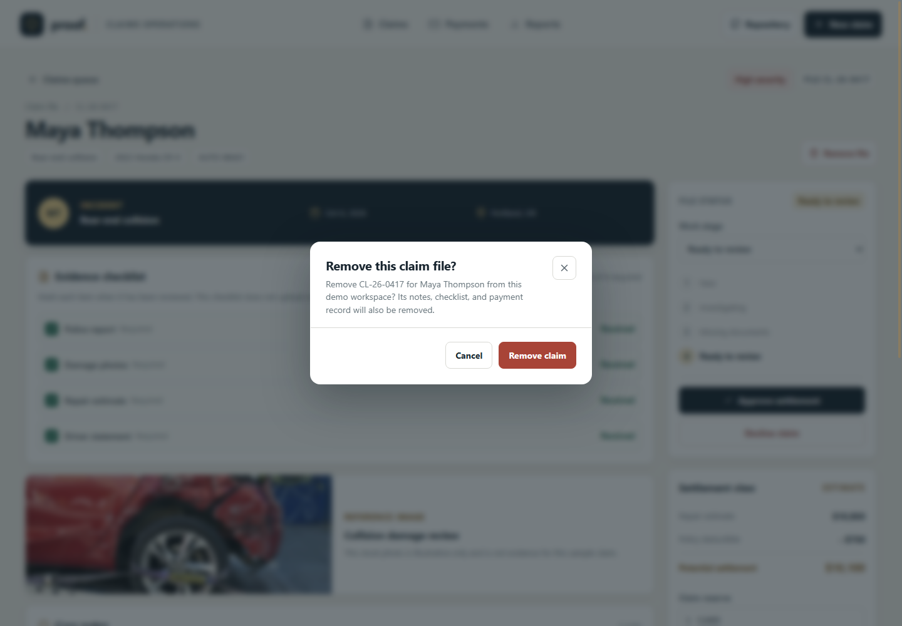 |
| Place payment on hold | 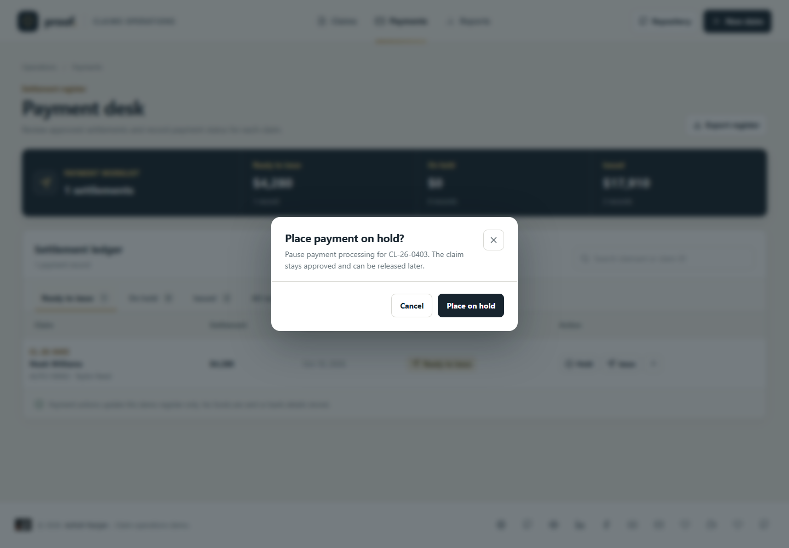 |
| Release payment hold | 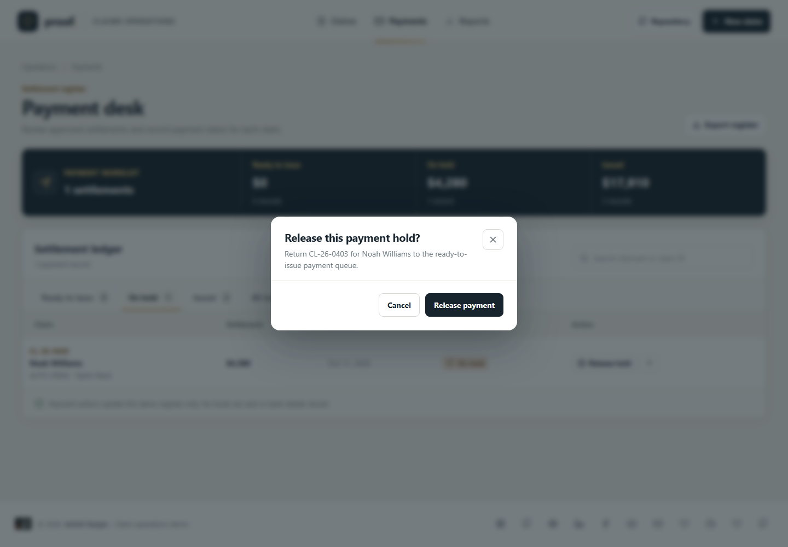 |
| Issue settlement | 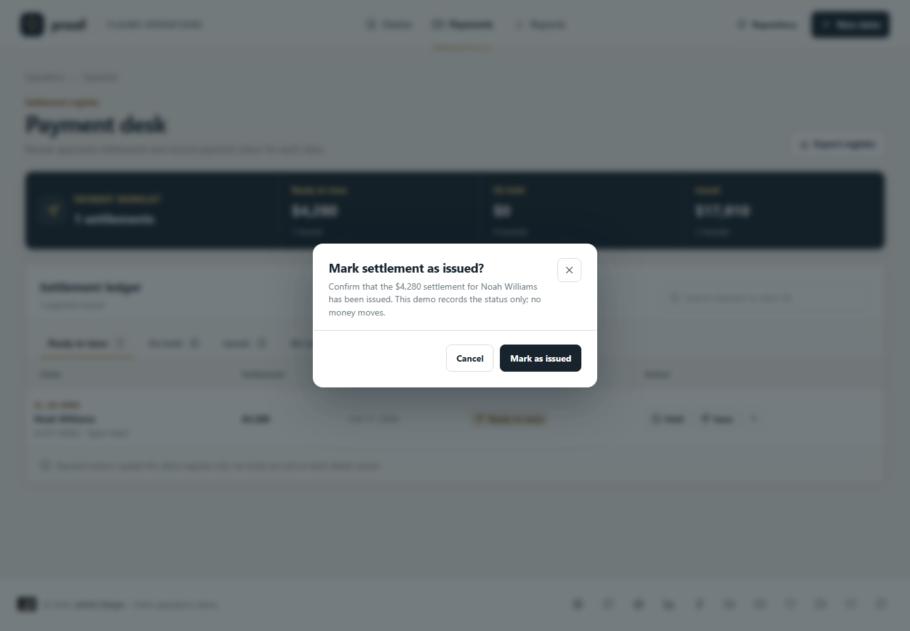 |

## Image attribution

The locally saved vehicle damage reference image is by [Usman Malik](https://unsplash.com/photos/kE__1vnDxg4), sourced from [Unsplash](https://unsplash.com/) under the [Unsplash License](https://unsplash.com/license). The file is included as `public/vehicle-damage.jpg`.

## Future improvements

These capabilities need a backend and are not implemented in this frontend demo:

- Shared claims, accounts, and role-based permissions.
- Secure document uploads, storage, and evidence access controls.
- Carrier, repair network, payment provider, and notification integrations.
- Server-side audit history and operational reporting across teams.

## Links

- Portfolio: [https://www.ashishranjan.net](https://www.ashishranjan.net)
- GitHub: [https://github.com/a2rp](https://github.com/a2rp)
- CodePen: [https://codepen.io/ash1198](https://codepen.io/ash1198)
- LinkedIn: [https://www.linkedin.com/in/aashishranjan](https://www.linkedin.com/in/aashishranjan)
- Facebook: [https://www.facebook.com/theash.ashish/](https://www.facebook.com/theash.ashish/)
- YouTube: [https://www.youtube.com/@ashishranjan-ashz?sub_confirmation=1](https://www.youtube.com/@ashishranjan-ashz?sub_confirmation=1)
- Email: [mailto:ash.ranjan09@gmail.com](mailto:ash.ranjan09@gmail.com)

## Support

- Support: [https://a2rp-donation-page.netlify.app/](https://a2rp-donation-page.netlify.app/)
- Buy Me a Coffee: [https://buymeacoffee.com/ashishranjan](https://buymeacoffee.com/ashishranjan)
- Patreon: [https://www.patreon.com/ashishranjan](https://www.patreon.com/ashishranjan)
